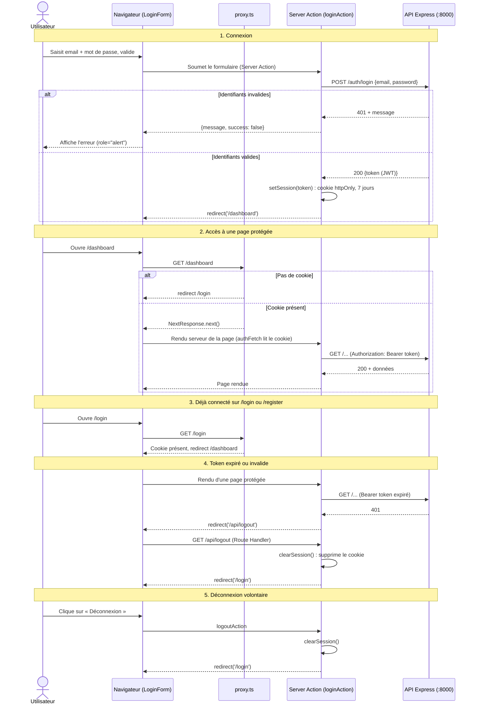

# Authentification

Le token JWT est renvoyé par l'API Express, puis stocké dans un cookie `httpOnly` par une Server Action.
Le navigateur n'a jamais accès au token en JavaScript.

## Points clés

- **Le proxy ne vérifie que la présence du cookie**, pas sa validité : c'est le back-end qui juge le token (cas 4).
- **Détour par `/api/logout`** : un Server Component ne peut pas supprimer un cookie, seuls un Route Handler ou une Server Action le peuvent.
- **Cookie `httpOnly`** : le token n'est pas lisible par le JavaScript du navigateur, ce qui limite l'impact d'une faille XSS.
- L'inscription (`registerAction`) suit le cas 1, avec `POST /auth/register`.

## Fichiers concernés

| Rôle | Fichier |
| --- | --- |
| Redirections selon le cookie | `src/proxy.ts` |
| Login, inscription, déconnexion | `src/app/actions/auth.ts` |
| Lecture / écriture / suppression du cookie | `src/lib/auth/session.ts` |
| Appels API (gestion du 401) | `src/lib/api/client.ts` |
| Suppression du cookie après un 401 | `src/app/api/logout/route.ts` |
